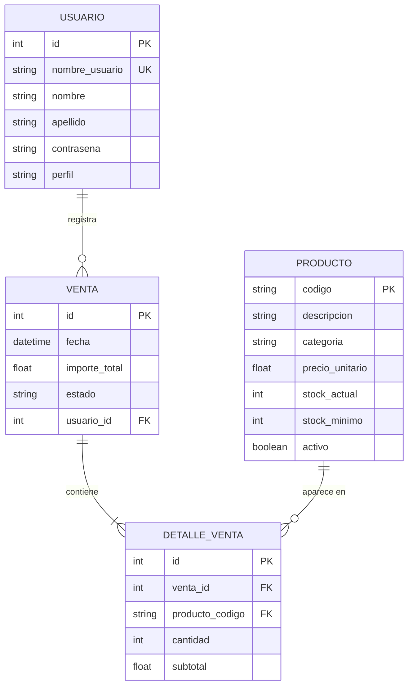

# Dietética Vida Natural — Sistema de Gestión Comercial

Sistema web de administración, control de inventario y punto de venta para la dietética **"Vida Natural"**, desarrollado como proyecto final para la materia **Algoritmos y Estructuras de Datos II**.

El sistema sustituye las planillas y registros manuales por una solución integral que automatiza el control de existencias, previene quiebres de stock mediante alertas de stock mínimo, garantiza la integridad del stock mediante transacciones atómicas y proporciona reportes de recaudación e histórico de ventas detallado.

---

## 🛠️ Tecnologías Utilizadas

- **Lenguaje Backend:** Java 17 / 21 (Java SE)
- **Servidor Web:** `com.sun.net.httpserver` (Servidor HTTP nativo en Java, sin necesidad de contenedores Tomcat ni dependencias externas pesadas)
- **Base de Datos:** MySQL 8.0 (Relacional, motor InnoDB con soporte de transacciones ACID)
- **Conector de Base de Datos:** MySQL Connector/J 8.3.0 (JDBC)
- **Gestor de Dependencias:** Apache Maven (`pom.xml`)
- **Frontend:** HTML5, CSS3 moderno (diseño comercial tipo ERP, sin dependencias de frameworks externos) y JavaScript nativo (`Fetch API`)

---

## 👥 Perfiles de Usuario y Requerimientos

El sistema implementa control de acceso basado en roles (RBAC) con dos perfiles diferenciados:

### 1. Perfil Administrativo
- **Registro de Ventas (Punto de Venta):**
  - Búsqueda de productos por código identificador.
  - Verificación en tiempo real de existencia y stock suficiente antes de incorporar el producto al carrito.
  - Cálculo automático de subtotales por producto (`precio unitario × cantidad`) y total general a pagar.
  - Descuento automático y atómico del stock disponible al confirmar la venta.
- **Inventario de Productos:**
  - Alta de nuevos productos (código, descripción, categoría, precio unitario, stock actual y stock mínimo).
  - Consulta general y filtrado en tiempo real por código o descripción.
  - Modificación de precios, existencias y datos del producto.
  - Baja lógica del producto (marcado como inactivo para no alterar ventas históricas).
- **Historial de Ventas:**
  - Vista general con métricas de facturación y buscador en tiempo real.
  - Desglose detallado (*acordeón*) con los artículos vendidos en cada operación.

### 2. Perfil Gerente
- **Control de Stock Mínimo (Crítico):**
  - Detección inmediata de artículos cuyo stock actual es menor o igual al stock mínimo configurado.
  - Indicador de unidades faltantes para reposición oportuna con proveedores.
- **Reporte de Recaudación:**
  - Cálculo del total recaudado en el sistema con opción de filtrado por rango de fechas (Desde / Hasta).
- **Auditoría e Historial de Ventas:**
  - Monitoreo de todas las ventas efectuadas, con fechas, importes y vendedores intervinientes.

---

## 📐 Modelo de Datos y Arquitectura

### Modelo Entidad-Relación (MER)



### Decisiones de Diseño Adoptadas

1. **Transacciones Atómicas (ACID) en Ventas:**  
   La venta y el descuento de existencias se procesan dentro de una misma transacción (`conn.setAutoCommit(false)`). Si algún producto se queda sin stock durante la operación, se ejecuta un `rollback` inmediato, impidiendo estados inconsistentes o ventas sin mercadería disponible.

2. **Baja Lógica de Productos:**  
   Los productos nunca se eliminan físicamente de la base de datos (`DELETE`), sino que se actualiza la bandera `activo = 0`. Esto garantiza la **integridad referencial histórica**: si un producto se deja de vender, las ventas pasadas que lo contienen siguen siendo consultables y válidas.

3. **Aislamiento de la Matemática de Ventas (`CalculadoraVenta`):**  
   Siguiendo buenas prácticas de arquitectura de software, el cálculo de subtotales, totales y redondeos se encapsula en una clase de servicio independiente. Esto garantiza que la lógica aritmética sea 100% testeable de manera unitaria sin acoplamiento a la base de datos.

4. **Inicialización y Migración Automática de la BD (`InicializadorBD`):**  
   Al arrancar `Main.java`, el sistema se conecta al servidor MySQL, crea la base de datos `vida_natural`, genera sus tablas y carga los usuarios y productos iniciales si la tabla se encuentra vacía. Esto facilita el despliegue inmediato en cualquier máquina de evaluación.

---

## 📁 Estructura del Proyecto

```text
VidaNatural/
├── pom.xml                                   # Configuración de dependencias Maven
├── database/
│   └── vida_natural.sql                     # Script DDL/DML de respaldo para MySQL
├── src/main/java/com/vidanatural/
│   ├── Main.java                            # Punto de entrada de la aplicación
│   ├── dao/
│   │   ├── ConexionBD.java                  # Conexión JDBC a MySQL
│   │   ├── InicializadorBD.java             # Creación automática de BD, tablas y datos
│   │   ├── ProductoDAO.java                 # CRUD y consultas de productos
│   │   ├── UsuarioDAO.java                  # Autenticación de usuarios
│   │   └── VentaDAO.java                    # Registro transaccional y consultas de ventas
│   ├── model/
│   │   ├── Categoria.java                   # Enum de categorías de dietética
│   │   ├── DetalleVenta.java                # Ítem individual de una venta
│   │   ├── EstadoVenta.java                 # Enum de estados (CONFIRMADA, etc.)
│   │   ├── Perfil.java                      # Enum de roles (ADMINISTRATIVO, GERENTE)
│   │   ├── Producto.java                    # Entidad Producto con reglas de stock
│   │   ├── Usuario.java                     # Entidad Usuario del sistema
│   │   └── Venta.java                       # Cabecera de venta con lista de detalles
│   ├── service/
│   │   ├── CalculadoraVenta.java            # Lógica aislada de cálculo numérico
│   │   ├── GestorProductos.java             # Lógica de negocio para productos
│   │   ├── GestorVentas.java                # Lógica de negocio para ventas
│   │   └── SistemaLogin.java                # Lógica de autenticación
│   └── server/
│       └── ServidorWeb.java                 # Servidor HTTP nativo y API REST JSON
└── web/
    ├── index.html                           # Interfaz unificada con header y vistas
    ├── style.css                            # Estilos limpios comerciales (paleta verde)
    └── app.js                               # Consumo de API, acordeones y filtros
```

---

## 🚀 Requisitos e Instalación

### Prerrequisitos
- **Java Development Kit (JDK):** Versión 17 o 21.
- **MySQL Server:** Versión 8.0 en ejecución en el puerto por defecto `3306`.
- **Editor / IDE:** Visual Studio Code (con Extension Pack for Java), IntelliJ IDEA, Eclipse o NetBeans.

### Pasos para Ejecutar

1. **Clonar o descargar el repositorio:**
   ```bash
   git clone <URL_DEL_REPOSITORIO>
   ```

2. **Verificar credenciales de MySQL:**
   Abrir `src/main/java/com/vidanatural/dao/ConexionBD.java` e `InicializadorBD.java`.  
   Verificar que `USUARIO` y `CONTRASENA` coincidan con su servidor MySQL local (por defecto usuario `root` y clave `12345678`).

3. **Ejecutar la Aplicación:**
   - En Visual Studio Code: Abrir la carpeta del proyecto, abrir `src/main/java/com/vidanatural/Main.java` y presionar **Run** (o `F5`).
   - O vía terminal con Maven:
     ```bash
     mvn compile exec:java -Dexec.mainClass="com.vidanatural.Main"
     ```

4. **Acceder desde el Navegador:**
   Ingresar a la URL:
   ```text
   http://localhost:8080
   ```

---

## 🔑 Usuarios y Credenciales de Demostración

| Rol | Nombre de Usuario | Contraseña | Capacidades Principales |
| :--- | :--- | :--- | :--- |
| **Administrativo** | `admin01` | `admin123` | Registrar ventas, validar stock, alta/baja/modificación de productos, historial de ventas. |
| **Gerente** | `gerente` | `gerente123` | Control de stock crítico/mínimo, reporte de recaudación por fechas, auditoría de ventas. |

---

## 📄 Formato para Informe Académico

En caso de requerir la entrega del informe final solicitado por la cátedra:

- **Estudiante:** [Completar Nombre y Apellido]
- **Materia:** Algoritmos y Estructuras de Datos II
- **Año de cursada:** 2026
- **Institución:** [Completar Nombre de la Institución]
- **Uso de Inteligencia Artificial:**
  - *Herramienta utilizada:* Asistente de IA (Gemini / Claude / Antigravity).
  - *Cómo colaboró durante el desarrollo:* Asistencia en el diseño del modelo entidad-relación, diagramado de clases UML, arquitectura del servidor HTTP en Java puro y maquetado de interfaz web responsiva estilo ERP.
